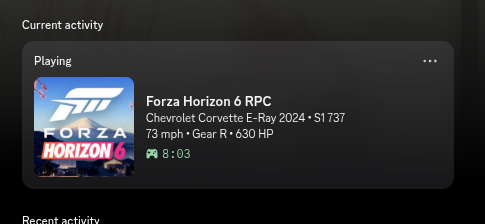
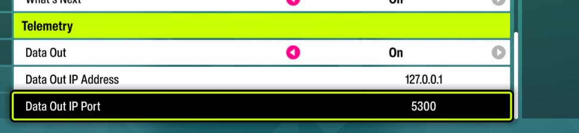

> [!WARNING]
> **This project is outdated and no longer maintained.**
>
> Forza Discord Rich Presence now lives in **[Glow L!VE Desktop](https://github.com/glow-moe/Glow-Live-Desktop)**.
> It supports Forza Horizon 6 and Forza Horizon 5 through the same Data Out telemetry, plus League of Legends and more, and shows your live session on Discord, your glow.moe page and an OBS overlay. It updates itself.
>
> 👉 **[Download Glow L!VE Desktop](https://github.com/glow-moe/Glow-Live-Desktop/releases)**

---

# Forza Horizon 6 Discord RPC

Discord Rich Presence bridge for **Forza Horizon 6** (also works with FH5). Reads Forza's `Data Out` UDP telemetry and mirrors your live driving state to your Discord profile: car, class, speed, gear, RPM, race position, lap times.

Works on **Linux** (native or Proton) and **Windows**.



## Features

- Live car name, class and PI from a hot-reloadable `car_names.json` lookup
- Unknown car ordinals get auto-logged to `unknown_cars.log` so you can add them later
- Race mode display: `P3 • Lap 2 • 287 mph`
- Free-roam display: `145 mph • Gear 5 • 610 HP`
- Per-class small image (D / C / B / A / S1 / S2 / X)
- Best lap shown on hover
- mph / km/h toggle
- Graceful Discord reconnect if the client restarts

## Setup

### 1. Enable telemetry in Forza

`Settings → HUD and Gameplay → Telemetry`

- **Data Out:** On
- **Data Out IP Address:** `127.0.0.1`
- **Data Out IP Port:** `5300`



### 2. Install Python dependency

```bash
pip install -r requirements.txt
```

(On Debian/Ubuntu use a venv: `python3 -m venv .venv && .venv/bin/pip install -r requirements.txt`.)

### 3. (Optional) Use your own Discord application

The script ships with my Discord Client ID. If you'd rather use your own app and asset images:

1. Create an app at https://discord.com/developers/applications
2. Upload Rich Presence asset images named `forza`, `class_d`, `class_c`, `class_b`, `class_a`, `class_s1`, `class_s2`, `class_x`
3. Replace `DISCORD_CLIENT_ID` near the top of `forza_rpc.py`

### 4. Run

```bash
python forza_rpc.py
```

You should see:

```
Loaded 34 car names from car_names.json
Listening for Forza telemetry on 0.0.0.0:5300
Connected to Discord.
```

Start driving in Forza and your Discord profile updates within ~5 seconds.

## Configuration

Edit the constants at the top of `forza_rpc.py`:

| Constant            | Default     | Purpose                                |
|---------------------|-------------|----------------------------------------|
| `DISCORD_CLIENT_ID` | (mine)      | Your Discord application ID            |
| `LISTEN_PORT`       | `5300`      | UDP port Forza sends telemetry to      |
| `UPDATE_INTERVAL`   | `5.0`       | Seconds between Discord updates        |
| `IDLE_TIMEOUT`      | `10.0`      | Seconds without telemetry before "Idle"|
| `UNITS`             | `"mph"`     | `"mph"` or `"kmh"`                     |

## Adding car names

When the script sees a car ordinal not in `car_names.json`, it appends a line to `unknown_cars.log`:

```
  "3771": "?",  // S1 737
```

Find the car name in-game and edit `car_names.json`:

```json
  "3771": "Chevrolet Corvette E-Ray 2024",
```

The script **hot-reloads** `car_names.json` every 30 seconds, no restart needed.

Pull requests with new car names welcome.

## Notes on FH6 packet format

Forza Horizon 6 hasn't released yet. This implementation assumes the same 324-byte Dash format used by FH4 and FH5. If FH6 changes the format, the offsets in `parse_horizon_packet` will need adjustment.

## Troubleshooting

**`Discord not reachable yet (ConnectionRefusedError)`**
Discord client isn't running, or you're on Snap/Flatpak Discord (sandbox blocks the IPC socket). Use the official `.deb` or symlink the IPC socket out of the sandbox.

**`Address already in use` on startup**
Another instance is using port 5300. Kill it: `lsof -i :5300` or `ss -ulnp | grep 5300`.

**Discord shows nothing in profile**
Make sure "Display current activity as a status message" is enabled in Discord settings → Activity Privacy.

## License

MIT
